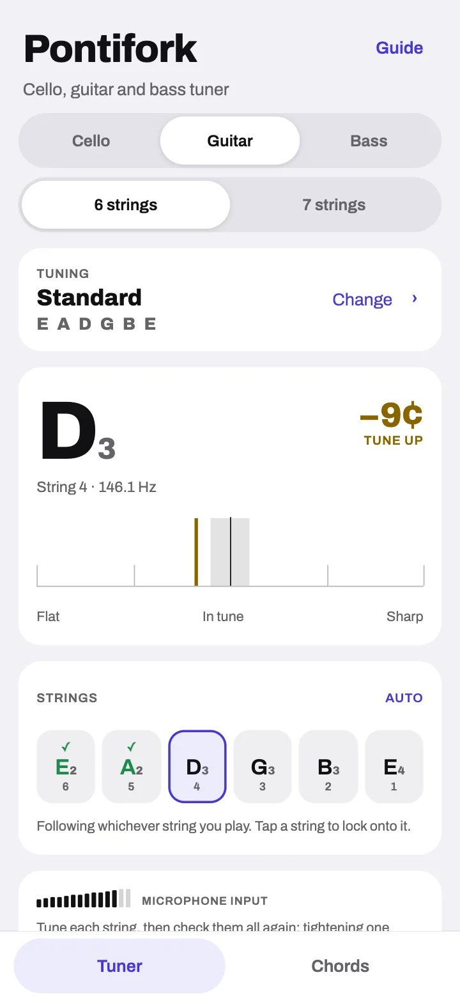
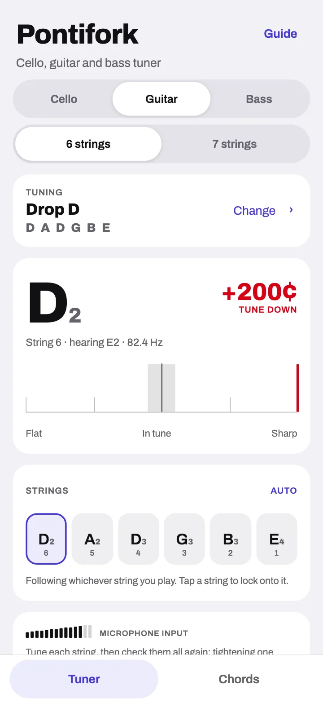
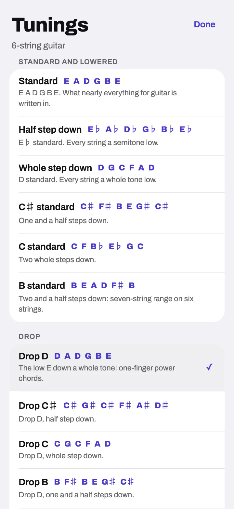
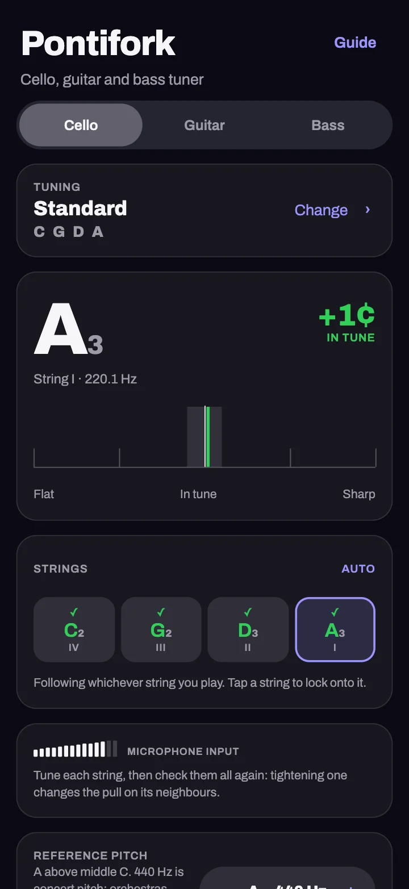
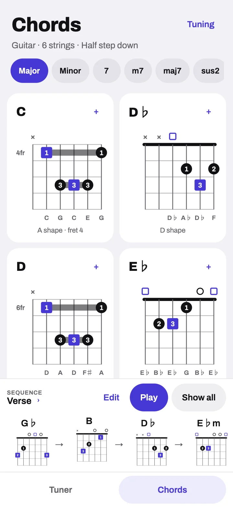
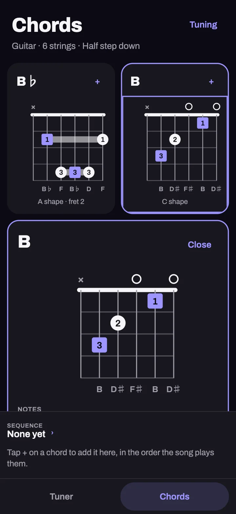
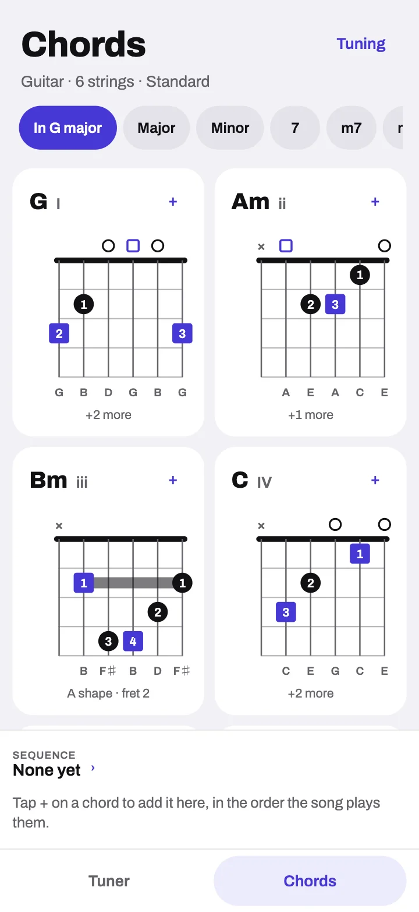
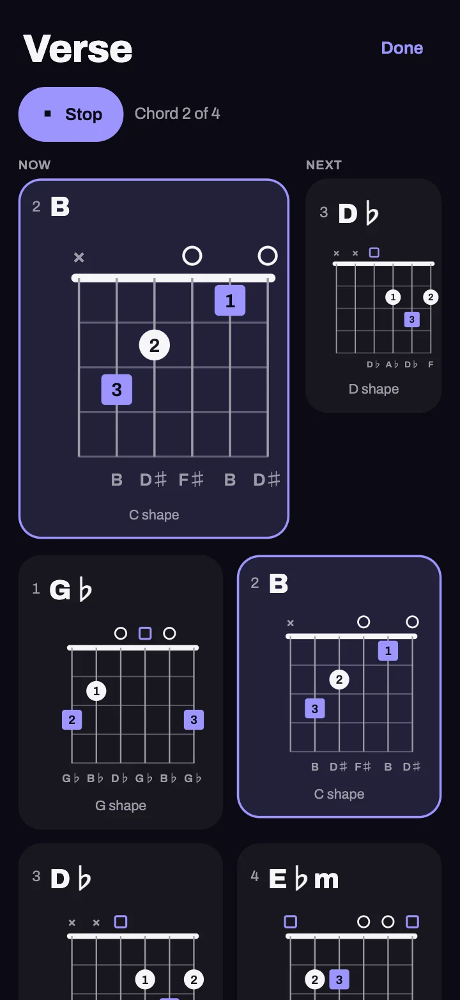

<p align="center">
  
</p>

<h1 align="center">Pontifork</h1>

<p align="center">
  Every string, in tune — a tuner and chord book for <strong>cello</strong>, <strong>guitar</strong> (6 and 7
  strings) and <strong>bass</strong> (4, 5 and 6 strings), for iOS, Android and any browser.<br>
  <a href="https://pontifork-online.bermeo.dev/">Open the tuner</a> · <a href="https://pontifork.bermeo.dev/">Product site</a> · <a href="#the-chord-book">The chord book</a> · <a href="#publish-on-vercel">Publish on Vercel</a> · <a href="#the-icon">The icon</a>
</p>

<p align="center">
  
  
  
  
</p>

It is the tuner from [Ponticello](https://github.com/GMBermeo/ponticello)
forked into an app of its own: the same dual-rate pitch engine, generalised
from the cello's range to everything from a five-string bass in drop A
(27.5 Hz) to the upper frets of a guitar. Built with Expo SDK 58 and React
Native 0.88.

## What it does

- **Measures against the string, not the nearest note.** Moving from standard
  to drop D, the low string reads "D2 · hearing E2 · +200¢ · tune down", not
  "E2, in tune".
- **Follows whichever string you play**, or tap a string to lock onto it when
  you are bringing it a long way.
- **Ticks each string** once it has been held in tune for a moment (with a
  haptic tap on phones), and un-ticks it if it drifts while you tune the rest.
- **Reference pitch** from A = 415 Hz (baroque) to 466 Hz, in whole hertz.
- **Keeps the screen awake** while listening, and releases the microphone when
  you leave the tuner or switch apps. Nothing is recorded or sent anywhere.
- **Runs in any browser**, and installs to a phone's home screen as a web app.

## The chord book

<p align="center">
  
  
  
  
</p>

A second tab lists the 12 major and 12 minor chords, and the 7, m7, maj7,
sus2, sus4, 5, dim and aug chords of every root, for the instrument, tuning
and capo in use.

- **Shapes follow the tuning.** The book lists chords by how they sound. A
  half step down, B's page shows the C shape you know, and says so; a whole
  step down it is B♭; with a capo on 2, D. Drop tunings keep the shapes and
  fret the low string two higher; open tunings, DADGAD and the cello's
  scordaturas get their own shapes, found by search.
- **The shapes players learn.** On guitar, each chord's open shape and the E
  and A shape barres; on seven strings, the E shape on the low string too.
  Bass and cello chords are found within one hand's reach.
- **Keys.** Pick a key and its chords open in degree order (I, ii, iii…), and
  come first on every other page.
- **Sequences.** Tap + to add chords in the order a song plays them. Keep as
  many as you like; play one through, two seconds a chord, silently. Each
  remembers the tuning it was made for and offers to switch back.
- **Diagrams your way.** Finger numbers or note names in the dots, the root as
  a square, every position of the chord's notes up to the twelfth fret, a
  left-handed mirror, and a tap to hear the chord at your reference pitch.

## Tunings

| Setup | Tunings |
|---|---|
| Cello | Standard (C G D A), half step down, Bach Suite No. 5 (A→G), Kodály Sonata Op. 8 (B F♯ D A) |
| Guitar, 6 strings | Standard, half step down (E♭), whole step down (D), C♯, C and B standard · Drop D, C♯, C, B, A♯/B♭, A · Double drop D · Open D, D minor, E, G, A, C · DADGAD |
| Guitar, 7 strings | Standard (B E A D G B E), half step down, whole step down · Drop A, G♯/A♭, G, F♯ |
| Bass, 4 strings | Standard, half step down, whole step down, C♯, C and B (BEAD) standard · Drop D, C♯, C, B, A♯/B♭, A · Tenor (ADGC) |
| Bass, 5 strings | Standard (B E A D G), half step down, whole step down · Drop A · High C (EADGC) |
| Bass, 6 strings | Standard (B E A D G C), half step down, whole step down · Drop A |

Every note of every tuning is on the [product site](https://pontifork.bermeo.dev/#tunings).

## Running it

```sh
npm install
npm run web       # browser; press "Enable microphone"
npm run ios       # Expo Go or a dev build
npm run android
```

The microphone needs a secure context on the web: `localhost` works, a LAN IP
over plain HTTP does not.

## Android release APK

```sh
npm run apk
```

Builds a release APK for arm64 phones and copies it to
`releases/Pontifork-v<version>.apk` (ignored by git), ready to attach to a
GitHub release. The version is `expo.version` in `app.json`; bump it and
`android.versionCode` together, or a phone will not take the new APK as an
update. It is signed with the debug keystore, like Ponticello's: fine for
sideloading, not for the Play Store. See [`tools/build-apk.sh`](tools/build-apk.sh)
for the JDK, SDK and proxy it expects.

## Publish on Vercel

The tuner and its product site are two Vercel projects from this one
repository, each on its own domain:

| Project | Domain | Root Directory | Config |
|---|---|---|---|
| Web app | `pontifork-online.bermeo.dev` | repository root | [`vercel.json`](vercel.json) |
| Product site | `pontifork.bermeo.dev` | `docs` | [`docs/vercel.json`](docs/vercel.json) |

**The web app.** Import the repository and leave **Root Directory** at the
root; `vercel.json` sets the rest (*Other* framework, `npm ci`,
`npm run build:web`, output in `dist/`). Add `pontifork-online.bermeo.dev`
under **Domains**. `npm run build:web` is `expo export --platform web` (a
single-page app: `web.output` is `single`), and `vercel.json`:

- falls back to `index.html` for any path that is not a file, so a deep link
  such as `/chords` opens the app (Vercel checks the filesystem first, so
  `robots.txt`, `sitemap.xml` and every asset are served as they are);
- sends the old `/docs/…` addresses to the same page on the product site, permanently;
- caches Expo's content-hashed bundles and fonts forever;
- allows the microphone to this origin only, so another site that embeds the
  tuner in a frame cannot listen through it.

**The product site.** Import the repository again, set **Root Directory** to
`docs` and **Framework Preset** to *Other*, leave the build command empty, and
add `pontifork.bermeo.dev`. `docs/.vercelignore` keeps the maintainers' notes
out of it, and `docs/404.html` answers any address that is not a page.

Both answer `X-Robots-Tag: noindex` on their `*.vercel.app` addresses, so
search engines only ever list the two real domains. Try either before
deploying: `npm run build:web && npm run preview:web` serves the app on
port 4173, and `npm run preview:site` the site on 4174, each applying its own
`vercel.json` in Vercel's order.

The web app is installable: `public/index.html` (Expo's page template) links a
manifest, touch icon and maskable icon, and sets the ground colour so there is
no white flash in dark mode. Vercel serves it over HTTPS, which browsers
require before they open a microphone.

### Search and link previews

Both domains are written to be found and shared:

- **Titles and descriptions** that fit a search result (60 and 160
  characters), a canonical address, and Open Graph and Twitter cards with the
  1200 × 630 link-preview image at an absolute address.
- **Structured data** (JSON-LD, schema.org): the site describes itself, its
  author, the app (`SoftwareApplication`), its source code, the six tuning
  steps (`HowTo`) and the tour video; the app describes itself as a
  `WebApplication`.
- **`robots.txt` and `sitemap.xml`** on each domain; the site's lists its
  screenshots and video too. `llms.txt` on the site summarises Pontifork for
  AI search tools.
- **Per page in the app**: each route renders `PageMeta`
  (`src/components/ui/PageMeta.web.tsx`), which writes its own title,
  description, canonical address and robots rule. The tuner and the chord
  book are indexed; the tuning list and the saved sequences are not.

`npm run check:site` (part of `npm run verify`) fails when any of this goes
missing or drifts: a title too long, a canonical on the wrong domain, a
preview image that is not deployed, structured data that does not parse, a
HowTo out of step with the page, or a sitemap entry that is not a route.

## The icon

The icon is made the way Ponticello's is: one hand-drawn master,
[`assets/logo/pontifork-icon.svg`](assets/logo/pontifork-icon.svg), from which
`python3 tools/make-icons.py` (or `npm run icons`) derives every other brand
file and checks the results. On iOS it is an **Icon Composer** document,
[`assets/expo.icon`](assets/expo.icon), with the fork and the waves as separate
Liquid Glass layers. See [`assets/logo/README.md`](assets/logo/README.md) for
the idea, the contract the master keeps and what is derived.

## Checks

```sh
npm run verify    # type check, lint, tests, site check
```

The tests are pure TypeScript in Node. They run the pitch engine over every
open string in the catalogue, check every tuning against the promise in its
name, check that every chord shape in every tuning sounds the chord it is
shown for (and that the synthesiser plays it in tune), check that the product
site lists exactly the catalogue, and cover the string targeting, smoothing,
sequences and settings validation. `npm run check:site` checks both domains'
pages: their files resolve, images and video are labelled, and the search
and link-preview tags, structured data, robots.txt and sitemaps are complete
(see [Search and link previews](#search-and-link-previews)).

The TypeScript is as strict as the compiler goes: `strict` plus
`noUncheckedIndexedAccess`, `exactOptionalPropertyTypes`,
`noPropertyAccessFromIndexSignature`, `verbatimModuleSyntax` and
`erasableSyntaxOnly`, and ESLint runs typescript-eslint's `strictTypeChecked`
and `stylisticTypeChecked` rules with zero warnings allowed. The build tools
in `tools/` are TypeScript too (`.mts`), run directly by Node 24.

| Command | What it does |
|---|---|
| `npm run build:web` | Export the web app into `dist/` |
| `npm run preview:web` | Serve `dist/` as Vercel will serve the web app |
| `npm run preview:site` | Serve `docs/` as Vercel will serve the product site |
| `npm run icons` | Derive every icon, splash, wordmark and web icon from the master |
| `npm run capture:shots` | Capture the site's screenshots and tour video from the web build |
| `npm run site:tunings` | Rewrite the site's tuning lists from the catalogue |

## Code map

See [AGENTS.md](AGENTS.md) for how a reading is made and the project's
conventions. The repo is indexed with [graft](https://www.npmjs.com/package/@nanonets/graft):
`graft map` for a tour, `graft ask "<question>" --source` to find code.

## Credits

App development by **Guilherme Yuri Bermeo** — [gm.bermeo.dev](https://gm.bermeo.dev).
Built with [Expo](https://expo.dev) and React Native; the pitch detector uses
the McLeod Pitch Method. On iOS the interface is set in the system face; on
Android, the web and in the brand it is
[Archivo](https://fonts.google.com/specimen/Archivo) by Omnibus-Type. Licensed
under the MIT License — see [`LICENSE`](LICENSE).
